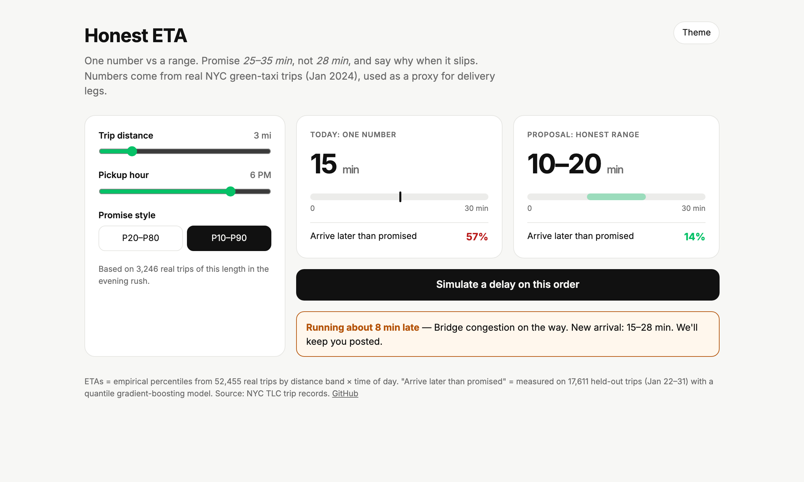
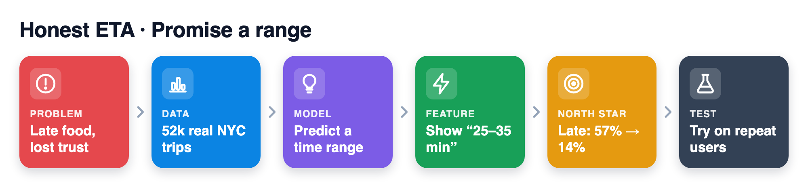
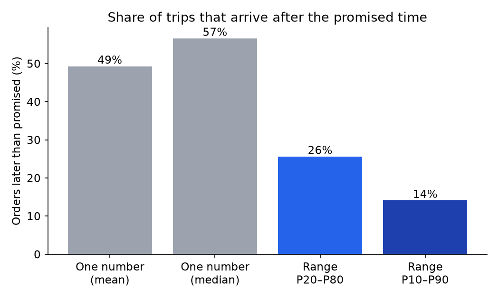
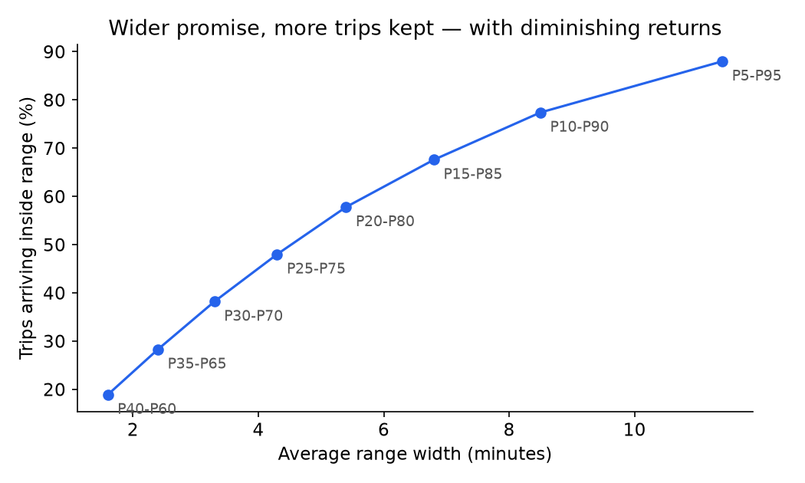

# Honest ETA: promise a range, not a number, and get late orders from 57% to 14%

> **PM case study + working prototype** · Delivery ETAs (Uber Eats) · Real NYC TLC taxi trips, Jan 2024 (proxy for delivery legs)



**▶ [Live demo](https://akhilesh360.github.io/honest-eta/)** · **🎬 [60-second walkthrough](docs/demo.webm)** · [Demo script](docs/demo-script.md)

## How it works



## 1. User and problem
Delivery customers, especially repeat users, who learn whether the app's promises hold. The app shows one number ("15 min"). Trip times are noisy, so a median-based number is late about half the time. A late order hurts trust more than a long estimate.

## 2. Product goal
Customers can trust the ETA: when the app makes a promise, the order arrives by then. When it can't, they hear why right away.

## 3. Solution and trade-offs
**Build:** show a range from predicted percentiles (default P10–P90, rounded to 5 min). If the live trip drifts past the upper bound, show one plain reason ("courier waiting at restaurant") and a new range.

**Trade-offs:** a wider range means fewer late orders but a less precise quote, and possibly lower conversion. P10–P90 is the default because P20–P80 is still late 1 in 4 times, and P5–P95 adds 3 min of width for 6.5 points.

**Not building:** a new routing or prep-time model (the point is the promise, not a better predictor); credits for late orders (a separate cost decision); per-user ranges (too complex before we know ranges help).

## 4. North Star metric
**Promise-kept rate:** % of delivered orders whose actual delivery time is ≤ the upper bound of the range shown at checkout. Arriving early counts as kept.

## 5. Supporting metrics
- **Adoption:** % of eligible orders shown a range ETA (rollout coverage).
- **Engagement:** "Where's my order" opens per order (lower means more trust).
- **Retention:** 28-day repeat-order rate for users in treatment vs control.
- **Conversion:** checkout conversion from store page to placed order.

## 6. Guardrail metrics
- Checkout conversion: stop if it falls by more than 1% relative to control.
- Late-order support contacts: must not rise.
- Minutes late when late: must not rise (a range alone doesn't fix this).
- Slip-reason accuracy: ≥ 95% match with courier/restaurant logs, from an audit sample. A wrong reason is worse than none.

## 7. Prioritization
High reach (every order sees an ETA), low effort (reuse existing duration predictions; add quantiles and copy). Ranked against:
- **Better point model:** costly, and late ~50% of the time by design.
- **Late-order credits:** recurring cost and doesn't prevent the broken promise.

## 8. Experiment and learning
**What the data in this repo shows (proxy, not Uber data).** NYC green-taxi trips, January 2024: 52,455 trips after cleaning. I trained a gradient-boosting model with quantile loss on pickup hour, weekday, distance and pickup zone. It trained on Jan 1–21 and was tested on Jan 22–31 (17,611 trips).

| Promise (held-out) | Late | Inside range | Avg width | Avg min late, when late |
|---|---|---|---|---|
| One number (mean) | 49.3% | – | 0 | 3.7 |
| One number (median) | 56.6% | – | 0 | 3.8 |
| Range P20–P80 | 25.6% | 57.8% | 5.4 min | 3.6 |
| Range P10–P90 | **14.1%** | 77.4% | 8.5 min | 3.7 |
| Range P5–P95 | 7.6% | 88.0% | 11.4 min | 4.1 |

 

- A range cuts *how often* trips are late by about three-quarters, but not *how late* they are when late. The slip banner covers that gap.
- Coverage is slightly below nominal (77% actual where P10–P90 means 80%), so production needs calibration.
- Taxi trips have no restaurant prep time, so real delivery variance is likely higher.

**Test.** A/B test on **repeat users first** in 2–3 cities: control is today's single ETA, treatment is a P10–P90 range plus slip reasons. Run for 2–4 weeks.

**Decision rule.** Ship to repeat users if promise-kept rate rises and conversion stays within the 1% guardrail. If conversion drops, test P20–P80 or different wording before scaling back.

**Next.** Calibrate ranges per city and hour (conformal) so nominal coverage matches real coverage, then extend to new users.

---
**How to run it**
```bash
python3 -m venv .venv && .venv/bin/pip install -r requirements.txt
.venv/bin/python scripts/get_data.py   # ~1.4 MB parquet into data/raw (git-ignored)
.venv/bin/python scripts/analyze.py    # results.json, charts, demo lookup (~5 min)
open docs/index.html                   # static demo; GitHub Pages serves /docs
```

**About:** Built by Sai Akhilesh Veldi. [Portfolio](#) · [LinkedIn](https://www.linkedin.com/in/akhileshsai/)
